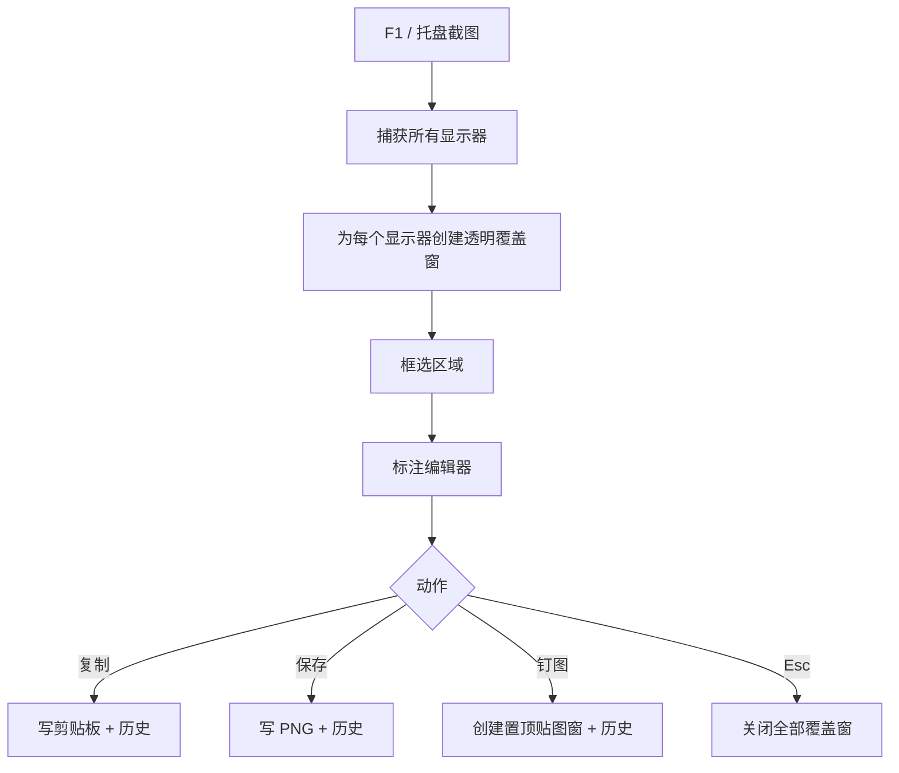

# P0 截图地基 · 需求与验收

> 项目：Pixmint  
> 版本：0.1.0  
> 日期：2026-10-18  
> 状态：已实现，Windows 交互链路已验证

## 1. 目标

完成跨平台截图工具的最小可用闭环：

1. 全局快捷键唤起截图覆盖层。
2. 框选区域并进入标注编辑器。
3. 标注结果可复制、保存、钉成贴图。
4. 提供托盘、设置、历史记录。

OCR、翻译、GIF、视频录制不在 P0 实现。

## 2. 功能范围

### 2.1 截图覆盖层

- 全局快捷键默认 `F1`，可在设置页修改。
- 按显示器创建透明全屏覆盖窗口。
- 先截屏再显示覆盖层，避免把工具条截进画面。
- 框选支持反向拖动、边界裁剪、实时尺寸提示。
- 按 `Esc` 取消截图。

### 2.2 标注编辑器

| 工具 | P0 能力 |
|---|---|
| 矩形 / 椭圆 | 拖动绘制、描边、颜色、线宽 |
| 线条 / 箭头 | 两点直线、按住拖动手绘、带箭头/纯线切换、六种线型 |
| 马赛克 | 笔刷、矩形两种模式、像素密度 1–100（越大越细腻）、画笔大小 8–48px、95% 不透明度 |
| 文字 | 输入、颜色、字号、粗体/斜体/下划线 |
| 序号 | 点击落点，自动递增 |
| 通用 | 选中移动、双击删除、撤销/重做、颜色板 |

手绘箭头必须满足：

- 箭头尖位于收笔位置。
- 收笔抖动或小钩子不能把箭头方向带歪。
- 线段进入箭头时沿箭头轴向，不能出现线头穿出或错位短枝。
- 箭头尺寸随线宽成比例变化。

### 2.3 输出动作

- 复制：复制到系统剪贴板。
- 保存：每次弹出系统保存对话框，由用户选择保存位置。
- 钉图：创建置顶贴图窗口。
- 关闭：取消截图。

### 2.4 贴图窗

- 无边框透明窗口、置顶、圆角。
- 初始位置与截图选区完全一致，按住图片即可自由拖动。
- 滚轮缩放，保持宽高比。
- 右键菜单：不透明度、复制、保存、鼠标穿透、关闭。
- 鼠标穿透可在贴图右键菜单切换；托盘不再提供批量恢复项，误开穿透可重启应用恢复。

### 2.5 设置与托盘

- 设置：快捷键、主题、语言偏好、开机自启、历史记录。
- 托盘：截图、设置、退出；应用默认只驻留托盘，不自动弹设置页。
- 历史记录：最近 30 张缩略图，可打开原图、清空。

## 3. 非目标

- OCR 与翻译（P1）
- GIF 录制（P2）
- MP4 录制与声音（P3）
- 云端同步、分享、账号体系
- Linux 支持
- 截图编辑器中的贴纸、模糊、画笔压感等高级能力

## 4. 关键流程

## 5. 技术实现

- 壳：Electron 40
- UI：React 19 + TypeScript 7
- 构建：electron-vite 6 + Vite 8
- 测试：Vitest 5 + Playwright Electron
- 截图：`desktopCapturer` 获取每个显示器缩略图
- 覆盖层：每显示器一个透明 `BrowserWindow`
- 标注：Canvas 2D，DPR 缩放，纯几何函数可单测
- 贴图：独立透明 `BrowserWindow`，主进程控制透明度/尺寸/鼠标穿透
- 历史：`userData/history` 下 PNG + 缩略图 + JSON 索引

## 6. 验收结果

| 项 | 结果 |
|---|---|
| TypeScript 类型检查 | 通过 |
| Vitest 单元测试 | 18/18 通过 |
| Electron 生产构建 | 主进程 / preload / renderer 全部通过 |
| 设置页冒烟 | `SMOKE_OK` |
| 覆盖层 E2E | 框选 640×420，手绘标注 895 像素，复制后剪贴板有图 |
| 贴图 E2E | 贴图创建、复制、关闭全部通过 |
| 真实屏幕捕获 | 当前开发机被 Windows 桌面捕获权限拒绝，需在普通交互桌面复测 |

## 7. 已知限制

1. 当前开发机是受限远程/隐藏桌面会话，DXGI 与 GDI 截图都返回拒绝访问；代码已给出权限错误提示，但真实屏幕捕获需在普通桌面会话验证。
2. macOS 的 vibrancy、屏幕录制权限、贴图穿透尚未在 Mac 实机验证。
3. 贴图透明度与穿透菜单使用 Electron 原生菜单，未做自动化覆盖。
4. P0 不包含自动更新与安装包签名。

## 8. 0.2.9 更新（2026-10-19）

- 截屏主路径改为 Windows GDI `CopyFromScreen` 常驻助手，单次约 160–300ms；`desktopCapturer` 作为回退。
- F1 后不再显示全屏蒙层或“正在截取屏幕”提示，覆盖层在新截图解码完成前保持隐藏。
- 覆盖层隐藏期间关闭 Chromium 后台节流，避免长间隔后 rAF 延迟。
- 启动时立即预热覆盖层并做隐藏式 1×1 预热渲染，首次 F1 实测 368ms。
- 选区新增 8 个拖拽手柄（4 角 + 4 边中点），支持自由缩放；最小 8×8，限制在屏幕内。
- 从左边/上边缩放时标注与撤销/重做历史同步平移，保持在屏幕原位置。
- 设置窗改为透明窗口，去掉圆角外方角底色。
- 设置窗四周增加透明阴影边距，内容卡片外显示柔和阴影。
- 截图后一级工具条右边缘与选区右边缘对齐。
- 当前交互桌面已验证 GDI 截屏；受限隐藏桌面仍可能需要普通登录会话。

## 9. 0.2.10 更新（2026-10-19）

- 冻结画面下，鼠标移动会查询下方最上层窗口及控件，并显示高亮与尺寸。
- 单击高亮窗口直接选中并进入标注；按住拖动仍保持手动框选。
- 窗口枚举使用常驻 PowerShell 助手，`DwmGetWindowAttribute(DWMWA_EXTENDED_FRAME_BOUNDS)` 取可见边框。
- 使用 MSAA `AccessibleObjectFromWindow` + `accHitTest` 取窗口内具体控件区域（视频播放器、工具栏、链接等）。
- 悬停区域保持原亮度，窗口外变暗；边框为实线。
- 排除 SnapGlass 自身、桌面、任务栏和 cloaked 窗口。
- 主进程负责 DIP/物理像素转换，查询节流 30ms，助手启动预热。
