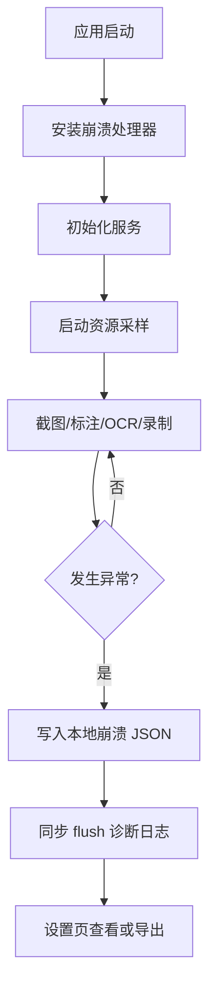

# 功能：稳定性与跨平台基础

编号：P4 | 状态：开发中 | 版本：v1

## 需求描述

Windows 端功能已经覆盖截图、标注、贴图、OCR、翻译、GIF 和视频录制，但稳定性主要依赖局部兜底，缺少全局异常采集、操作面包屑和资源采样。后续还要做 macOS 版本，如果继续把平台差异写进主进程，维护成本会快速上升。

本功能先建立不改变用户操作的基础层：

- 全局崩溃采集与本地诊断包
- 最近操作面包屑
- 内存、CPU、事件循环采样
- 设置与密钥的 schema 校验、损坏备份和原子写入
- 设置页诊断入口
- 跨平台 Provider 与 sidecar 的架构约束

## 设计决策

- 先做可观测性，再改截图和录制算法。没有证据的稳定性修复容易引入回归。
- 诊断数据默认只写本地，不上传截图、OCR 文字、剪贴板、窗口标题或文件路径。
- 日志从逐条同步写入改为 250ms 批量写入，单文件 2MB、最多 3 个文件，避免主进程被日志阻塞和磁盘无限增长。
- 设置和密钥采用 schema 白名单、损坏文件备份、临时文件 + rename 原子替换；写入失败不能假装成功。
- 平台差异后续收进 `platform/` Provider，主进程业务层不直接依赖 PowerShell、Win32 或 Windows OCR。
- macOS 采用 Electron 共享 UI + Swift sidecar 的方向，不另起一套 SwiftUI 产品线。

## 验收标准

- [x] 主进程未捕获异常、未处理 Promise、渲染进程退出、子进程退出、无响应都会生成本地崩溃报告。
- [x] 崩溃报告包含版本、平台、架构、系统版本、兼容模式、内存和最近 100 条操作。
- [x] 日志批量写入、分级、轮转、脱敏，单条消息截断。
- [x] 设置文件损坏时保留 `.corrupt-` 备份并使用默认值启动。
- [x] 设置与密钥写入采用原子替换，未知字段被丢弃。
- [x] 设置页可查看日志路径、崩溃报告数量、兼容模式并打开目录。
- [x] 支持通过 `PIXMINT_USER_DATA_DIR` 指定测试/便携数据目录。
- [x] 崩溃报告和诊断信息导出为单个 JSON 报告。
- [x] 通用 SidecarClient 抽取完成。
- [x] 平台 Provider 抽取完成（Windows 捕获/窗口/OCR）。
- [x] 压测脚本覆盖 200 次覆盖层、100 次 OCR、可配置录制时长。
- [ ] 压测已在目标 Windows 机器通过并记录结果。
- [x] Windows CI 运行 typecheck、单元测试和构建。
- [x] OCR 串行队列、临时脚本唯一路径与清理。
- [x] 翻译请求 15 秒超时，避免 IPC 长期挂起。
- [x] 只允许受信任应用页面导航，拒绝新窗口和 webview。
- [x] 权限请求只对受信任应用页面放行。
- [x] 桌面捕获兜底增加 5 秒超时，自动测试不再弹模态框。
- [x] 新增 `--capture-once` 正常启动验证入口，走真实 `startCapture` 路径。
- [x] 已试验 canvas + ImageBitmap 冻屏方案；500 次无改善后回退，保留 img 方案。
- [x] 压测报告记录 renderer private/shared bytes，确认增长在 Chromium 私有原生内存。
- [x] 1000 次长跑确认线性增长；renderer reload 回收无效并撤回。
- [x] 所有 BrowserWindow 开启 sandbox，并通过 smoke/设置/覆盖层/贴图 E2E。
- [ ] 生产 CSP 移除开发地址并做生产构建回归。
- [ ] CI 双平台矩阵和发版门禁。

## 变更记录

| 日期 | 版本 | 变更 | 原因 |
|---|---|---|---|
| 2026-10-22 | v1 | 建立诊断、崩溃、采样、设置原子写入基础 | 稳定性与跨平台维护 |
| 2026-10-22 | v1 | 增加测试 userData 覆盖与 smoke 加载失败日志 | 沙箱/桌面验证 |
| 2026-10-22 | v1 | 增加正常启动 capture-once 验证入口 | 区分 UI 与真实捕获 |
| 2026-10-22 | v1 | 调查覆盖层内存增长，canvas 试验无效并回退 | 内存稳定性 |

## 关联文件

- 实现文件：
  - `src/shared/diagnostics.ts`
  - `src/main/breadcrumbs.ts`
  - `src/main/diagnostics.ts`
  - `src/main/crash-report.ts`
  - `src/main/metrics.ts`
  - `src/main/settings-utils.ts`
  - `src/main/settings-store.ts`
  - `src/main/secret-store.ts`
  - `src/main/sidecar/protocol.ts`
  - `src/main/sidecar/client.ts`
  - `src/main/fast-capture.ts`
  - `src/main/window-snap.ts`
  - `src/main/platform/types.ts`
  - `src/main/platform/index.ts`
  - `src/main/platform/win32/index.ts`
  - `src/main/diagnostics-export.ts`
  - `src/main/index.ts`
  - `scripts/soak/lib.cjs`
  - `scripts/soak/overlay-soak.cjs`
  - `scripts/soak/ocr-soak.cjs`
  - `scripts/soak/recording-soak.cjs`
  - `src/preload/index.ts`
  - `src/shared/api.ts`
  - `src/shared/types.ts`
  - `src/renderer/src/settings/SettingsApp.tsx`
- 测试用例：`docs/test-cases/P4-stability-foundation.md`
